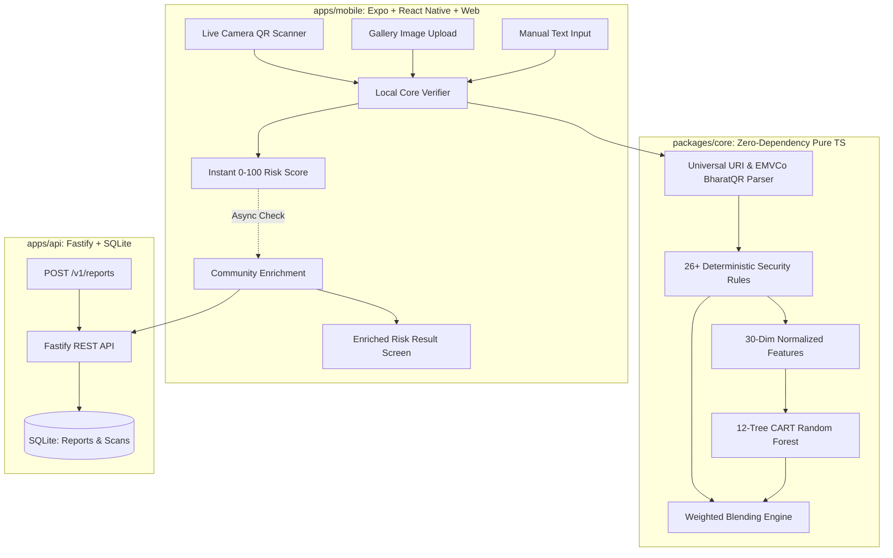
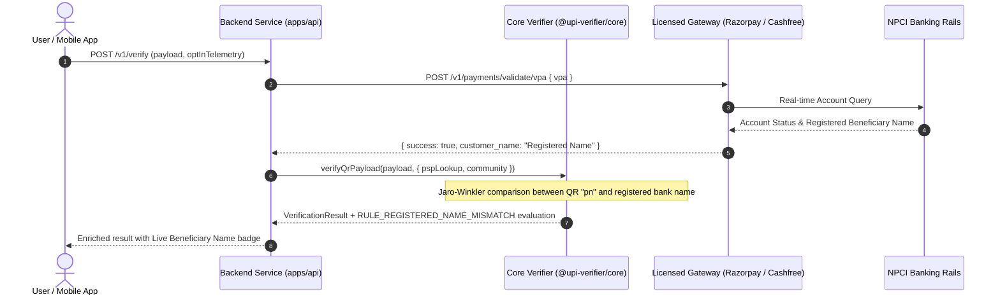

# UPI QR Verifier
> **Cover Title: Payment QR Code Alert System**

[](https://github.com/ChandrashekharaKM/UPI_QR_Verifier/actions/workflows/ci.yml)
[](https://www.typescriptlang.org/)
[](https://opensource.org/licenses/MIT)

A complete, cross-platform TypeScript application that scans or uploads UPI payment QR codes **BEFORE** the user pays, decodes and validates parameters against NPCI specifications, performs heuristic security analysis, executes on-device machine learning inference, and displays a calibrated 0–100 risk score (Safe / Suspicious / High Risk) with plain-language explanations.

> [!WARNING]
> **Risk-Warning Disclaimer**: This tool is an automated risk-warning advisory instrument based on protocol rules, heuristic patterns, and machine learning indicators. It is **never a guarantee of safety**. Users must always verify recipient identity independently before authorizing payments.

---

## Architecture Overview



---

## Real-World QR Code & Protocol Support

The engine is engineered specifically to verify real-world QR codes encountered at physical merchant counters, shop standees, payment apps, and digital checkouts:

1. **EMVCo & BharatQR Physical Standees (`000201...`)**:
   - Full recursive Tag-Length-Value (TLV) parser handling root tags and nested templates.
   - Merchant Account Templates (tags `26–51`): automatic detection of NPCI/UPI GUIDs (`A000000524`, `upi`, `in.org.npci`, `com.upiqr`) and extraction of VPA handles.
   - Standard tag extraction: MCC (`52`), currency code mapping (`53`: `356` $\rightarrow$ `INR`), transaction amount (`54`), tip/convenience fee indicators (`55–57`), merchant name (`59`), and city (`60`).
   - Bitwise CRC-16/CCITT-FALSE validation (`poly 0x1021`, `init 0xFFFF`) calculated over the payload up to `"6304"`. Corrupted or tampered check digits immediately trigger `RULE_EMV_BAD_CRC`.
   - Seamlessly normalized into canonical `UpiFields` with `source: 'emv'`.

2. **Universal Deep-Link & App-Specific Protocol Normalization**:
   - Transparently parses and normalizes standard `upi://pay`, debit-pull `upi://collect`, autopay `upi://mandate`, vendor schemes (`phonepe://pay`, `paytmmp://pay`, `tez://upi/pay`, `gpay://upi/pay`, `bhim://pay`), and Android `intent://...#Intent;scheme=upi;...` payloads.
   - Proactive defense against pull-payment fraud: `upi://collect` and `upi://mandate` trigger `RULE_COLLECT_OR_MANDATE` (`severity: high`) warning that scanning will deduct or schedule recurring debits rather than receiving funds.

3. **Security Hardening & Homoglyph Evasion Defense**:
   - Multi-pass recursive percent decoding (up to 3 passes) neutralizes double-encoding evasion attacks (`%2540` $\rightarrow$ `@`).
   - Unicode homoglyph detector normalizes Cyrillic, Greek, and mathematical lookalike glyphs spoofing trusted merchant brands or bank handles.
   - Zero-width and invisible character stripping detects Unicode steganography (`U+200B`, `U+FEFF`, bidirectional overrides) and triggers `RULE_HIDDEN_UNICODE`.
   - **Zero external dependencies**: `packages/core` operates 100% offline with zero runtime dependencies.

4. **Robust Physical Image Decoding (`apps/mobile/lib/`)**:
   - Hardware-accelerated `BarcodeDetector` API utilized first on supported web and modern platforms.
   - Multi-scale image normalization: clamps large high-resolution camera photos to 1024px and upscales small cropped images (< 500px).
   - Bradley-Roth local integral image adaptive thresholding handles severe glare, specular reflections, and shadows on laminated counter stickers.
   - Multi-pass fallback decoder evaluates linear contrast stretching, 65% center region-of-interest cropping, 90°/180°/270° orientation rotations, and dual inverted/non-inverted QR module scans.

5. **Multi-QR Code Detection & Resolution ("Never Silently Pick One")**:
   - Counter standees and cash registers often place multiple QR stickers side-by-side or stacked (e.g. PhonePe, Paytm, BharatQR, and UPI).
   - Multi-barcode spatial decomposition decomposes images into overlapping horizontal thirds, vertical slices, and $2\times 2$ quadrants alongside iterative bounding-box masking.
   - **User Confirmation Guarantee**: If more than one QR code is found in an image, the system **never silently picks one**. An interactive candidate selection sheet (`MultipleQrModal`) displays each code's payee name, VPA handle, pre-filled amount, protocol badge, and security warnings, requiring the user to explicitly select which code they intend to verify.

6. **Pluggable Real-World VPA Verification Layer (`VpaVerifier`)**:
   - **Honest System Transparency**: NPCI offers **no public API** to validate whether a UPI ID/VPA currently exists or is actively registered on bank servers. The system does not simulate or fake live bank network pings.
   - **Pluggable Architecture**: Core exposes a pluggable `VpaVerifierProvider` interface and `VpaVerifierRegistry`:
     - **`OfflineStructuralVerifier` (Default, 100% Offline)**: Verifies VPA address format, matches the handle against the official 120+ NPCI PSP banking allowlist (identifying sponsor banks like HDFC Bank, SBI, ICICI, Axis, etc.), verifies MCC and business name consistency, validates EMVCo / BharatQR CRC-16 checksums, and screens for zero-width characters and homoglyph evasion.
     - **`CommunityReputationVerifier` (Network Threat Intelligence & Decay-Weighted Telemetry)**:
       - **Report Deduplication**: Deduplicates submissions per reporter (`device_hash`). If the same reporter submits multiple reports within a 24-hour window, duplicate stuffing is rejected (`409 Conflict`), and subsequent reports beyond 24h update the existing submission rather than inflating the raw count.
       - **Exponential Time Decay (30-day Half-Life)**: Older reports diminish in threat weight according to $w = 2^{-\Delta t / 30}$, where $\Delta t$ is the age in days:
         - Fresh reports ($\le 7$ days): weight $\approx 0.85 - 1.0$ (immediate active campaign alerts).
         - 30-day old reports: weight $= 0.50$ (half threat weight).
         - 60-day old reports: weight $= 0.25$.
         - Stale/reallocated accounts ($> 90$ days): weight $< 0.125$, preventing ancient burner records from permanently blacklisting recycled bank handles.
       - **Granular Period Breakdown**: Provides temporal activity breakdowns (`within7Days`, `within30Days`, `within90Days`, `olderThan90Days`) and ranked threat categories.
       - **Scoring Integration**: Plugs directly into the core scoring engine ($8 \times \text{decayedScore}$, clamped to 25 points) and activates `RULE_COMMUNITY_HIGH_REPORTS` when decayed threat score $\ge 1.5$.
     - **`PspLookupVerifier` (Licensed Gateway Integration — Disabled by Default)**:
       - **Live Beneficiary Name Retrieval**: Connects through licensed Payment Aggregator APIs (Razorpay, Cashfree) to query NPCI for the actual account holder's registered bank name.
       - **Jaro-Winkler Fuzzy Matching**: Compares the returned beneficiary name against the QR's declared payee name (`pn`). Significant differences trigger `RULE_REGISTERED_NAME_MISMATCH` (`severity: high`, weight 75).
       - **Strict Privacy & Redaction**: Operates behind environment flags (`PSP_LOOKUP_ENABLED=false` by default). **Never logs raw VPAs** without explicit user consent (`optInTelemetry`).
     - **`ThreatIntelVerifier` (Google Safe Browsing & PhishTank URL Feeds — API Server Only)**:
       - **Phishing & Malware Detection**: Validates URL-type QRs against Google Safe Browsing and PhishTank threat feeds.
       - **API Server Only (Never From Client)**: Mobile apps never connect directly to third-party threat intel APIs, keeping client IP addresses private, saving mobile battery, and preventing API key exposure in application bundles.
       - **Strict Timeout & Graceful Degradation**: 3-second timeout (`THREAT_INTEL_TIMEOUT_MS=3000`). If external feeds experience outages or rate limits, verification degrades gracefully and never blocks payments.
       - **Rule Integration**: Confirmed threats activate `RULE_THREAT_INTEL_MALICIOUS` (`severity: critical`, weight 95).
     - **Clear UI Labeling & Disclaimers**: In the app UI and API responses, each provider is individually badged (`Offline Structural (Default)`, `Community Reputation (Decay Weighted)`, `Licensed Gateway (Live Bank Name)`, and `Threat Intelligence (URL Scan)`), displaying granular pass/fail checks alongside an honest system transparency notice.


7. **Multilingual Brand Impersonation Detection (`brand-keywords.json` & `brand-validator.ts`)**:
   - Comprehensive dictionary covering Indian banking institutions (State Bank of India, HDFC Bank, ICICI Bank, Axis Bank, Punjab National Bank, Bank of Baroda), digital wallets & PSPs (Paytm, PhonePe, Google Pay, BHIM, CRED), government portals (Income Tax, Cybercrime, Traffic Police, EPFO), and essential public utilities (electricity boards, BESCOM, water boards).
   - Multi-script support including native Devanagari (`स्टेट बैंक`, `पेटीएम`, `बिजली`, `आयकर`) and Latin phonetic transliterations (`esbii`, `peytm`, `bijli`).
   - High-precision contextual classification keeping false positives low: distinguishing official deceptive support claims ("SBI Customer Care", "Paytm KYC Helpline") from legitimate agents ("SBI Mutual Fund", "SBI Life Insurance").

8. **PSP Allowlist Freshness Monitoring (`scripts/check-psp-freshness.ts`)**:
   - Official NPCI TPAP and banking PSP directory (`packages/core/src/validators/psp-allowlist.json`) tracked with schema version and `updatedAt` ISO metadata.
   - Automated CLI script (`pnpm check-freshness`) and CI step that calculates allowlist age and warns when handles have not been updated within 180 days.

9. **Property-Based Fuzz Testing (`fast-check`)**:
   - Automated property-based fuzz testing across all payload parsers (`packages/core/test/fuzz-parsers.test.ts`).
   - Validates that over 1,000+ randomly generated Unicode strings, mutated deep links, and corrupted EMVCo buffers never throw unhandled exceptions and always terminate with typed results within strict time bounds.

10. **Physical Sticker Tampering Warning & Pre-PIN Verification Step**:
   - **Persistent Standee Advisory**: For any merchant QR code (identifiable by MCC, terminal ID, BharatQR/EMV standee structure, or commercial payee name), a persistent tamper warning instructs users to physically inspect counter standees for raised edges, peel marks, or sticker overlays pasted over genuine shop codes.
   - **Pre-PIN Name Check Step**: Displays a dedicated mandatory verification step: *"Check the name shown in your UPI app before you enter your PIN"*, educating users to cross-check the live bank-resolved beneficiary name on their UPI app (PhonePe, Google Pay, Paytm, BHIM) before typing their UPI PIN.

11. **Mobile UI Policy Enforcement & Testing (`result-policy.test.tsx`)**:
   - **No Bare "Safe"**: Low-risk QRs display `SAFE (Low Risk)` accompanied by the mandatory caveat: *"No major risk indicators found; recipient identity NOT independently verified"* when live bank name retrieval is offline.
   - **Verification Coverage Audit**: Granularly lists checks that actively ran vs checks that did not run offline.
   - **Two-Step Confirmation on HIGH_RISK**: Tapping "Continue Anyway" triggers a high-visibility modal (`CRITICAL SCAM WARNING`) with "Cancel (Recommended)" and "Dismiss Warning" options to prevent accidental bypass.
   - Tested using `@testing-library/react-native` and `react-test-renderer` in [`apps/mobile/test/result-policy.test.tsx`](apps/mobile/test/result-policy.test.tsx).

12. **Production-Hardened Fastify API (`apps/api`)**:
   - **Global & Route Rate Limiting**: Global sliding window rate limiting (100 req/min) and endpoint-specific limits (15 req/min on `/v1/reports`, 60 req/min on `/v1/verify`), returning standard HTTP 429 responses.
   - **Payload Body Size Limit**: 16 KB strict limit (`bodyLimit: 16384`) rejecting oversized or malformed payloads with HTTP 413.
   - **Privacy-Preserving Request Logging**: Request serializers strictly redact `req.body`, `rawBody`, query parameters, and cleartext VPAs from application logs.
   - **CORS Allowlist**: Configurable origin verification via `CORS_ORIGIN` rejecting unauthorized browser domains.
   - **OpenAPI & Swagger Documentation**: Route documentation at `/documentation` and machine-readable spec at `/openapi.json` synchronized with Zod validation schemas.

13. **CI Pipeline & Containerization**:
   - Multi-stage Dockerfile ([`apps/api/Dockerfile`](apps/api/Dockerfile)) with healthcheck and persistent SQLite volumes.
   - GitHub Actions workflow ([`.github/workflows/ci.yml`](.github/workflows/ci.yml)) featuring linting, strict typechecking, test suites, freshness checks, mobile web export build, API Docker build, and a nightly scheduled cron job for the real-world fixture suite.

14. **Real-World Acceptance Test Suite (`docs/real-world-fixtures/`)**:
   - 29 production-grade QR code fixtures with full `manifest.json` generated using the `qrcode` library.
   - Covers legitimate grocery/pharmacy/fuel counters, BharatQR EMVCo standees, app deep links (PhonePe, GPay Tez, Android Intent), P2P mobile transfers, round bait lures, tampered EMV check digits, bank helpline impersonation, pull collect debits, and AutoPay mandates.
   - Comprehensive degraded variants simulating real-world capture challenges:
     - **Rotated 15°**: Hand-held tilted camera capture angles decoded via arbitrary angle bilinear rotation and spatial alignment.
     - **Blurred**: Defocus and motion-blurred counter photos restored via local adaptive thresholding.
     - **JPEG-Compressed**: 8x8 block DCT coefficient quantization artifacts simulating WhatsApp/social messaging forwards.
     - **Low Contrast**: Washed-out thermal paper prints and specular glare recovered via linear contrast stretching.
     - **Photographed-on-a-Screen Simulation**: LCD scanlines, pixel moire raster grids, and radial screen illumination vignettes.
   - Automated acceptance tests in both [`apps/mobile/test/real-world-acceptance.test.ts`](apps/mobile/test/real-world-acceptance.test.ts) (pixel decoding + category evaluation) and [`packages/core/test/real-world-acceptance.test.ts`](packages/core/test/real-world-acceptance.test.ts) (core verification invariants).

15. **15 Core Acceptance Scenarios Matrix (`acceptance-15.test.ts`)**:
   Automated unit and integration acceptance suites ([`packages/core/test/acceptance-15.test.ts`](packages/core/test/acceptance-15.test.ts) and [`apps/mobile/test/acceptance-15.test.ts`](apps/mobile/test/acceptance-15.test.ts)) strictly enforce the 15 real-world acceptance criteria:

   | # | Payload Type | Expected Outcome | Rule / Verification Behavior |
   |---|---|---|---|
   | 1 | Valid `upi://pay` merchant with MCC | `SAFE` | Score $\le 30$ with mandatory unverified identity caveat |
   | 2 | P2P phone-number VPA | `SAFE` | Score $\le 30$, validates 10-digit mobile VPA syntax (`isPhoneVpa: true`) |
   | 3 | Valid EMVCo BharatQR with correct CRC | `SAFE` | Validates CRC-16/CCITT-FALSE; `RULE_EMV_BAD_CRC` does not trigger |
   | 4 | Same EMV QR with one character altered (bad CRC) | `SUSPICIOUS` or higher | Triggers `RULE_EMV_BAD_CRC` (`severity: high`, weight 75) |
   | 5 | EMV QR with swapped VPA & recomputed CRC | Evaluated normally | CRC passes; evaluated based on new VPA properties (scam VPA $\rightarrow$ `HIGH_RISK`) |
   | 6 | `phonepe://pay?...` and `paytmmp://pay?...` deep links | Parsed same as `upi://` | Canonicalized into `UpiFields` preserving original scheme |
   | 7 | `upi://collect?...` | `HIGH_RISK` | Triggers `RULE_COLLECT_OR_MANDATE` (pull-payment debit fraud defense) |
   | 8 | "Refund / KYC / prize" scam text in `tn` | `HIGH_RISK` | Triggers `RULE_REFUND_VERIFY_NOTE` (`severity: critical`, weight 85) |
   | 9 | Bank-helpline impersonation VPA | `HIGH_RISK` | Triggers `RULE_VPA_IMPERSONATION` (`severity: critical`, weight 85) |
   | 10 | Shortened URL, IP-host URL, punycode URL, http URL | `HIGH_RISK` | Triggers `RULE_SHORTENED_URL`, `RULE_IP_ADDRESS_URL`, `RULE_PUNYCODE_DOMAIN`, `RULE_HTTP_NOT_HTTPS` |
   | 11 | Parameter pollution (`pa` twice) | `HIGH_RISK` | Sets `hasDuplicateParams: true` and triggers `RULE_DUPLICATE_PARAMETERS` |
   | 12 | Hidden unicode / homoglyph in `pn` | `SUSPICIOUS` or higher | Triggers `RULE_HIDDEN_UNICODE` (`severity: high`, weight 85) |
   | 13 | `wifi:`, `mailto:`, `tel:` utility QRs | "Not a payment QR" | `isNonPaymentQr: true`, score 0, not flagged as a scam |
   | 14 | Image with 2 QR codes | UI asks which one | Multi-QR detection extracts all codes; displays `MultipleQrModal` |
   | 15 | Image with no QR | Clear "No QR found" error | Decodes 0 codes; displays diagnostic guidance tips (lighting, glare, angle) |

16. **Manual Real-Device Test Protocol (`docs/REAL_WORLD_TESTING.md`)**:
   - Complete manual test protocol covering 5 real-world physical scanning scenarios:
     - **Scenario A**: Physical shop counter standee under ambient fluorescent / LED lighting.
     - **Scenario B**: Secondary phone display screen (OLED / LCD) with raster reflections and backlight glare.
     - **Scenario C**: WhatsApp compressed screenshot / forwarded image.
     - **Scenario D**: Low-light evening or dim kiosk counter ($< 50\text{ lux}$).
     - **Scenario E**: Laminated counter sticker with direct specular overhead spotlight glare.
   - Structured verification log template and False Positive (FP) / False Negative (FN) triage decision tree.
   - **Mandatory Safety Rules**: Never test against real individuals' accounts or real money; use ₹0 or small self-owned test accounts only.

---

## Monorepo Structure

```
UPI QR Verifier/
├── packages/
│   └── core/                 # Pure TypeScript, zero external dependencies
│                             # UPI parser, validators, rule engine, features, ML tree traversal, scoring
├── ml/                       # TypeScript ML training & evaluation pipeline (tsx)
│                             # Synthetic data generator, CART / Random Forest, metrics & ablation
├── apps/
│   ├── api/                  # Fastify + Zod + SQLite reputation backend service
│   └── mobile/               # Expo + React Native + react-native-web cross-platform application
├── docs/
│   ├── real-world-fixtures/  # Acceptance test QR PNG fixtures, degraded variants, and manifest.json
│   ├── REAL_WORLD_TESTING.md # Manual real-device test checklist, logging template, and triage
│   ├── sample-fixtures/      # Supplementary generated test QR images
│   └── project-report-mapping.md # Academic & technical synopsis mapping document
└── docker-compose.yml        # Containerized SQLite backend deployment
```

---

## Security Rules Matrix

The deterministic engine evaluates 26 specialized security rules categorized by threat domain:

| Rule ID | Severity | Weight | Condition & Purpose | Plain-Language Advisory |
|---|---|---|---|---|
| `RULE_EMV_BAD_CRC` | `high` | 75 | Checksum mismatch in BharatQR / EMVCo tag 63 | "EMVCo / BharatQR payload checksum verification failed. The QR code data may be corrupted or tampered." |
| `RULE_COLLECT_OR_MANDATE` | `high` | 75 | QR initiates a pull debit collect or auto-debit mandate (`upi://collect`, `upi://mandate`) | "**CRITICAL:** This QR requests money from you instead of paying you. In UPI, you never scan a QR code or enter your PIN to receive funds." |
| `RULE_HIDDEN_UNICODE` | `critical` | 85 | Homoglyphs, zero-width characters, or bidi overrides in VPA / Name / Remarks | "Hidden or deceptive Unicode characters detected (such as Cyrillic/Greek homoglyphs or zero-width spaces) designed to spoof legitimate entities." |
| `RULE_NON_UPI_SCHEME` | `critical` | 85 | Scanned code is a web URL or non-UPI URI | "Does not contain a direct UPI link. Opening external web links can lead to phishing or malware." |
| `RULE_HTTP_NOT_HTTPS` | `high` | 70 | Destination link uses unencrypted HTTP | "Uses unencrypted HTTP protocol. Legitimate banking portals require HTTPS." |
| `RULE_IP_ADDRESS_URL` | `high` | 80 | URL points to raw IP address | "Points directly to an IP address rather than an authenticated bank domain." |
| `RULE_SHORTENED_URL` | `medium` | 65 | URL uses link shortening service (`bit.ly`, etc.) | "Destination address is masked by a link shortener, concealing the actual payment recipient." |
| `RULE_SUSPICIOUS_TLD` | `medium` | 60 | Domain ends in spam-heavy TLD (`.xyz`, `.top`, etc.) | "Domain uses an extension heavily associated with disposable phishing campaigns." |
| `RULE_PUNYCODE_DOMAIN` | `high` | 80 | Domain contains punycode characters (`xn--`) | "Contains punycode characters, a common technique for visual homograph impersonation." |
| `RULE_THREAT_INTEL_MALICIOUS` | `critical` | 95 | Flagged by Google Safe Browsing or PhishTank as malware/phishing | "**CRITICAL THREAT:** Confirmed malicious URL flagged on global threat intelligence feeds as active phishing, malware, or social engineering." |
| `RULE_UNKNOWN_PSP` | `medium` | 45 | Handle suffix is not in official NPCI allowlist | "UPI handle is not on the recognized NPCI banking PSP allowlist." |
| `RULE_VPA_HIGH_ENTROPY` | `medium` | 35 | Username has high Shannon entropy ($H \ge 3.4$) | "Contains randomized character sequences typical of disposable burner accounts." |
| `RULE_VPA_EXCESSIVE_DIGITS` | `low` | 25 | High ratio of numeric digits in non-phone VPA | "Contains an unusually high concentration of numeric digits." |
| `RULE_VPA_IMPERSONATION` | `critical` | 85 | VPA local part contains bank/helpline keywords | "Impersonates official customer care, banking support, or government bodies." |
| `RULE_MISSING_PAYEE_NAME` | `low` | 25 | Parameter `pn` is omitted | "QR does not declare a registered payee name (`pn`)." |
| `RULE_NAME_VPA_MISMATCH` | `medium` | 35 | Jaro-Winkler similarity between Name and VPA is low | "Declared payee name has virtually no correlation with the UPI handle." |
| `RULE_REGISTERED_NAME_MISMATCH` | `high` | 75 | Bank-registered name from licensed PSP lookup differs from declared QR name (`pn`) | "Beneficiary name mismatch: The bank-registered name on this UPI ID does not match the merchant name shown on the QR. Funds may be diverted." |
| `RULE_URGENCY_KEYWORDS` | `high` | 60 | Name or remarks contain "refund", "prize", "KYC" | "High-risk psychological urgency or prize bait keywords detected." |
| `RULE_HIGH_AMOUNT` | `high` | 50 | Pre-filled amount $\ge ₹25,000$ or exceeds limit | "Pre-filled with an unusually high amount. Verify before entering PIN." |
| `RULE_ROUND_BAIT_AMOUNT` | `medium` | 35 | Pre-filled amount matches lure pricing (9999, etc.) | "Amount matches common psychological lure pricing frequently seen in promotional scams." |
| `RULE_REFUND_VERIFY_NOTE` | `critical` | 85 | Remarks ask for "refund" or "verification" | "**CRITICAL:** You NEVER scan a QR code or enter a PIN to receive money. Scanning this will deduct funds." |
| `RULE_MISSING_MC_BUSINESS` | `medium` | 40 | Name claims commercial entity but lacks 4-digit MCC | "Payee name claims commercial business but lacks an official 4-digit MCC." |
| `RULE_DUPLICATE_PARAMETERS` | `high` | 65 | Query string contains repeated parameter keys | "Parameter pollution detected. Repeated keys can trick payment apps into charging an attacker." |
| `RULE_UNKNOWN_PARAMETERS` | `low` | 20 | Non-standard query parameters present | "Carries unexpected extra query parameters deviating from standard NPCI format." |
| `RULE_OVERSIZED_PAYLOAD` | `low` | 20 | Payload length exceeds 512 characters | "QR payload significantly exceeds typical compact UPI QR code dimensions." |
| `RULE_INVALID_CURRENCY` | `high` | 75 | Currency parameter is not INR | "Transaction specifies non-INR currency. Standard domestic UPI strictly requires INR." |
| `RULE_COMMUNITY_HIGH_REPORTS` | `high` | 60–85 | 2+ crowd-sourced scam reports on record | "This recipient has multiple scam reports registered by community users." |
| `RULE_COMMUNITY_RECENT_REPORTS`| `medium` | 40 | Reports logged within the last 7 days | "Scam reports logged very recently, indicating active malicious campaigns." |

---

## Scoring Formula & Calibration

The final risk score ($0$ to $100$) is calculated using a calibrated weighted blend:

$$\text{FinalScore} = \text{Clamp}_{[0, 100]}\Big(\text{RuleScore} \times 0.65 + \text{MLScore} \times 0.35 + \text{CommunityPenalty}\Big)$$

Where:
- **$\text{RuleScore}$**: Deterministic score derived from the maximum triggered rule weight plus diminishing returns on remaining headroom:
  $$\text{AccumulatedScore} = W_0 + \sum_{j=1}^{k} \frac{W_j}{100} \times (100 - \text{AccumulatedScore}) \times 0.45$$
- **$\text{MLScore}$**: Random Forest predicted scam probability scaled to $[0, 100]$.
- **$\text{CommunityPenalty}$**: $\min(25, \text{ReportCount} \times 8)$.

### Thresholds & Categorization

| Score Range | Category | Color | Mandatory UI Policy |
|---|---|---|---|
| **0 – 30** | `SAFE` | `#10B981` (Emerald) | **Never bare "Safe"**: When no registered-name check ran (offline default), states: *"No major risk indicators found; recipient identity NOT independently verified"*. When bank-verified via licensed gateway, states: *"No major risk indicators found; recipient identity confirmed via bank records"*. |
| **31 – 70** | `SUSPICIOUS` | `#F59E0B` (Amber) | Displays highlighted warning cards explaining intermediate risk factors. |
| **71 – 100** | `HIGH_RISK` | `#EF4444` (Crimson) | Prominent warning reticle. "Continue anyway" requires an explicit two-step confirmation dialog. |

---

## Setup & Quickstart

### Prerequisites
- **Node.js**: v20 or v22 LTS
- **pnpm**: v10+ or v12+ (`npm install -g pnpm`)

### 1. Installation
```bash
# Clone the repository
git clone https://github.com/ChandrashekharaKM/UPI_QR_Verifier.git
cd UPI_QR_Verifier

# Install all monorepo dependencies
pnpm install

# Approve build scripts for better-sqlite3 and esbuild
pnpm approve-builds --all
```

### 2. Run Tests & Typecheck
```bash
# Run 426 automated unit, integration, property-based fuzz, ML held-out, and real-world image decoding tests across core, api, ml, and mobile
pnpm test

# Run strict TypeScript typecheck across all 4 workspaces (0 errors)
pnpm typecheck

# Build core library
pnpm build:core
```

#### Real-World Image Decoding Engine & Fixtures Test Suite
The testing suite includes automated end-to-end decoding tests (`apps/mobile/test/decoder-fixtures.test.ts`) that read actual PNG image files from disk into raw RGBA pixel buffers, decoding them through the multi-pass pipeline:
- **Orientation Tolerant**: 90°, 180°, and 270° rotated photos (`real_rotated_standee_90.png`, `real_rotated_standee_180.png`, `real_rotated_standee_270.png`).
- **Camera Defocus & Motion Blur**: Soft focus / blurred counter photos (`real_blurred_photo.png`).
- **Low Contrast & Glare**: Faded thermal prints and specular reflections recovered via linear contrast stretching (`real_low_contrast_standee.png`).
- **Small Stickers**: Low-resolution counter/table stickers (< 140px) decoded via 2x nearest-neighbor upscaling (`real_small_counter_sticker.png`).
- **Official BharatQR / EMVCo Standees**: CRC-16 validated merchant standees and bad-CRC detection (`real_bharatqr_emv_standee.png`, `suspicious_emv_bad_crc.png`).
- **Multi-QR Disambiguation**: Spatial decomposition across overlapping thirds, halves, and quadrants for images with multiple adjacent QR codes.

### 3. Start Backend Service
```bash
# Start API in development mode (port 3001)
pnpm --filter @upi-verifier/api dev

# Interactive Swagger documentation:
# Open http://localhost:3001/documentation in your browser
```

### 4. Start Mobile & Web App
```bash
# Start Expo development server (opens interactive terminal)
pnpm --filter @upi-verifier/mobile start

# Open Web version directly:
pnpm --filter @upi-verifier/mobile web

# Export static production web bundle:
pnpm --filter @upi-verifier/mobile build:web
```

---

## API Reference (`apps/api`)

### `GET /v1/health`
Health and diagnostic check.
```json
{
  "status": "ok",
  "version": "1.0.0",
  "timestamp": "2026-10-08T14:00:00.000Z",
  "uptime": 128.4
}
```

### `POST /v1/verify`
Full server-side verification enriched with community reputation.
- **Body**: `{ "payload": "upi://pay?pa=store@oksbi&pn=Store&am=200", "optInTelemetry": false }`
- **Response**: Full `VerificationResult` + `communityReputation` metrics. Privacy-safe: never stores raw payload unless `optInTelemetry` is true.

### `POST /v1/reports`
Submits an anonymized crowd-sourced scam report.
- **Body**: `{ "vpa": "scam@ybl", "reason": "fake_support", "note": "Impersonated bank care" }`
- **Response**: `201 Created` or `409 Conflict` (deduplicated per device hash).

### `GET /v1/vpa/:vpa/reputation`
Retrieves verified report statistics with device deduplication and exponential 30-day half-life decay.
- **Response**:
```json
{
  "vpa": "scam@ybl",
  "reportCount": 5,
  "uniqueReporters": 3,
  "decayedScore": 2.14,
  "recentReportCount": 2,
  "lastReportedDaysAgo": 1,
  "topCategories": ["fake_support", "phishing"],
  "breakdownByPeriod": {
    "within7Days": 2,
    "within30Days": 1,
    "within90Days": 0,
    "olderThan90Days": 0
  }
}
```

### `GET /v1/vpa/:vpa/verify` & `POST /v1/vpa/verify`
Runs real-world multi-provider VPA verification combining `OfflineStructuralVerifier`, `CommunityReputationVerifier`, and optional `PspLookupVerifier`.
- **Response**: Full `VpaVerificationResult` with individual provider checks, statuses (`verified_valid`, `unverified_format_valid`, `suspicious`, `high_risk`), and honest transparency disclosures.

---

## Licensed Gateway VPA Lookup Adapter (`PspLookupVerifier`)

While NPCI provides no public consumer API to validate live VPA existence, licensed Payment Aggregators (PAs) and Payment Gateways (PGs) — such as **Razorpay** and **Cashfree** — offer commercial "Validate VPA" APIs connected directly to NPCI sponsor banking rails.

`@upi-verifier/core` and `apps/api` feature a pluggable, modular adapter (`PspLookupVerifier`) that queries these commercial APIs when enabled.

### How it Works



1. **Jaro-Winkler Name Matching**: When enabled, the adapter computes the Jaro-Winkler fuzzy string similarity between the QR's declared payee name (`pn`) and the bank-registered beneficiary name returned by the gateway.
2. **`RULE_REGISTERED_NAME_MISMATCH`**: If the bank-registered name does not match the merchant name shown on the QR (Jaro-Winkler similarity $< 0.72$ without substring or word overlap), the engine triggers `RULE_REGISTERED_NAME_MISMATCH` (`severity: high`, weight 75).
3. **Invalid VPA Alert**: If the gateway indicates that the VPA does not exist or has been deactivated on bank servers (`isValid: false`), the engine triggers an immediate high-risk warning.

### How to Obtain API Keys

#### Razorpay ("Validate VPA" API)
1. **Create Business Account**: Sign up at [dashboard.razorpay.com](https://dashboard.razorpay.com/) and complete business KYC under RBI Payment Aggregator guidelines.
2. **Access API Keys**: In your merchant dashboard, go to **Settings > API Keys** and generate a `Key Id` and `Key Secret`.
3. **Enable Permissions**: Ensure the "Validate VPA" feature is activated under Payments/Verification in your merchant profile.

#### Cashfree ("UPI Validation" API)
1. **Create Merchant Account**: Sign up at [merchant.cashfree.com](https://merchant.cashfree.com/) and submit entity verification documentation.
2. **Access Verification Suite**: Navigate to **Verification Suite / Payouts > Developers > API Keys**.
3. **Copy Credentials**: Generate your `X-Client-Id` (`appId`) and `X-Client-Secret` (`secretKey`). Use the Gamma test environment for development.

### Environment Configuration

The provider is **disabled by default** to keep the core engine 100% offline and eliminate unintended API consumption:

```bash
# Enable licensed gateway adapter
PSP_LOOKUP_ENABLED=true

# Choose provider: 'razorpay' | 'cashfree' | 'mock'
PSP_LOOKUP_PROVIDER=razorpay

# Razorpay credentials
RAZORPAY_KEY_ID=rzp_live_xxxxxxxxxxxxxx
RAZORPAY_KEY_SECRET=xxxxxxxxxxxxxxxxxxxxxxxx

# Cashfree credentials (alternative)
CASHFREE_APP_ID=cf_app_xxxxxxxxxxxxxx
CASHFREE_SECRET_KEY=cf_secret_xxxxxxxxxxxxxxxxxxxxxxxx
CASHFREE_ENV=PROD # or TEST
```

> [!NOTE]
> For offline simulation and local testing without incurring API fees, set `PSP_LOOKUP_PROVIDER=mock`.

### Legal, Regulatory & Cost Caveats

> [!CAUTION]
> Before enabling licensed gateway verification in production, review the following commercial and regulatory constraints:

1. **Payment Aggregator (PA/PG) License Requirements**:
   - VPA validation endpoints are commercial services governed by Reserve Bank of India (RBI) Payment Aggregator Master Directions.
   - Licensed gateways only issue production API keys to registered business entities (Pvt Ltd, LLP, Sole Proprietorship with GST) with verified merchant accounts. Individual developers cannot obtain live production keys.
2. **Terms of Service (ToS) & Anti-Scraping Policies**:
   - Gateways strictly prohibit using VPA validation APIs for bulk scanning, unauthorized data scraping, or surveillance.
   - Validation must be performed only in connection with bona fide user payment transactions or checkout initiation.
3. **Digital Personal Data Protection (DPDP) Act 2023**:
   - Bank-registered beneficiary names constitute personal data under India's DPDP Act 2023.
   - Applications must never store, display, or distribute registered account-holder names beyond the transient transaction advisory screen without lawful processing grounds.
4. **Commercial Pricing Model (Per-Call API Costs)**:
   - Payment gateways charge commercial fees for each validation request (typically **₹1.00 to ₹3.00 + 18% GST** per call), deducted directly from your merchant balance.
   - Commercial gateways enforce strict rate limits (e.g. 10 to 60 QPS). Unthrottled scanning will deplete account credits or trigger rate limiting.

### Privacy & Redaction Policy: Zero Unconsented VPA Logging

> [!IMPORTANT]
> **Privacy Guarantee**: The backend service **NEVER logs raw VPAs** without explicit user consent.
> - In all application logs, diagnostic traces, and server outputs, VPAs are masked using deterministic SHA-256 truncation (`[anon_a1b2c3d4@okhdfcbank]`).
> - Raw QR payloads and cleartext VPAs are stored in SQLite scan records **only when the user explicitly enables opt-in telemetry** (`optInTelemetry: true`).

---

## Threat Intelligence URL Verifier (`ThreatIntelVerifier`)

Fraudsters frequently circulate physical stickers or digital QR codes that do not initiate a direct payment, but rather direct users to web URLs (`http://`, `https://`) hosting fake banking portals, phishing APK downloads, or credential harvesting pages.

To mitigate this threat vector, the system incorporates `ThreatIntelVerifier`, an adapter for global threat intelligence networks including **Google Safe Browsing** and **PhishTank**.

### Architecture: API Server Only (Never From Client)

```mermaid
sequenceDiagram
    autonumber
    actor Mobile as Mobile App / Client
    participant API as Backend Service (apps/api)
    participant Core as Core Verifier (@upi-verifier/core)
    participant Feeds as Threat Feeds (Google Safe Browsing / PhishTank)

    Mobile->>API: POST /v1/verify { payload: "https://phishing-site.xyz" }
    Note over Mobile,API: Mobile NEVER contacts external threat feeds directly
    API->>Feeds: POST /threatMatches:find (3000ms AbortController timeout)
    alt Response within 3000ms
        Feeds-->>API: Threat Match (MALWARE / SOCIAL_ENGINEERING)
    else Timeout or Upstream Outage
        Note over API: Graceful degradation: returns clean fallback; verification continues
    end
    API->>Core: verifyQrPayload(payload, { threatIntel })
    Core-->>API: VerificationResult (RULE_THREAT_INTEL_MALICIOUS triggered if match)
    API-->>Mobile: Result with "Threat Intelligence (URL Scan)" provider badge
```

1. **Client Privacy Protection**: The mobile application **never contacts Google Safe Browsing or PhishTank directly**. Calling third-party threat feeds from mobile devices leaks client IP addresses, exposes sensitive user browsing locations, drains device battery, and risks leaking secret API credentials embedded in the client APK.
2. **Strict Timeout & Graceful Degradation**: Upstream queries are governed by an `AbortController` with a strict 3000ms timeout (`THREAT_INTEL_TIMEOUT_MS=3000`). If external networks experience downtime, latency spikes, or rate limiting, the verifier **gracefully degrades** (marking the check inconclusive) and never throws an exception or blocks the user's scan workflow.
3. **Rule `RULE_THREAT_INTEL_MALICIOUS` (`severity: critical`, weight 95)**: When a confirmed malicious URL is detected, the engine activates this critical severity rule, raising the overall risk score to `HIGH_RISK` and highlighting the danger on the advisory screen.

### Environment Configuration

Threat intelligence lookup is **disabled by default**:

```bash
# Enable threat intelligence lookup
THREAT_INTEL_ENABLED=true

# Choose provider: 'google' | 'phishtank' | 'all' | 'mock'
THREAT_INTEL_PROVIDER=google

# Google Safe Browsing API Key (v4 Lookup API)
GOOGLE_SAFE_BROWSING_API_KEY=AIzaSy...

# PhishTank API Key (optional app key)
PHISHTANK_API_KEY=xxxxxxxxxxxxxxxxxxxx

# Query timeout in milliseconds (default: 3000)
THREAT_INTEL_TIMEOUT_MS=3000
```

> [!NOTE]
> When `THREAT_INTEL_ENABLED=true` without API keys, the service defaults to `mock` mode for local testing against built-in test URL patterns (e.g. `testsafebrowsing.appspot.com/s/phishing.html`).

---

## Machine Learning Pipeline & Retraining (`ml/`)

To generate new synthetic datasets, evaluate model performance, and re-export trees to the core engine:

```bash
# Run training, evaluation, ablation, and export pipeline:
pnpm --filter @upi-verifier/ml train
```

This updates:
1. `ml/reports/metrics.json` – Real evaluation metrics on held-out test splits.
2. `ml/reports/REPORT.md` – Evaluation report with synthetic data caveat notice.
3. `packages/core/src/model/model.json` – Compact tree structure consumed on-device.

---

## System Limitations

1. **Physical Sticker Tampering**: Criminals can physically paste fraudulent printed QR codes over legitimate merchant stands. The QR data itself may be syntactically valid while routing money to an unauthorized individual. Users must physically inspect counter QR stands for peeling or overlaid stickers.
2. **Zero-Day Scam Accounts**: A newly created bank account will have valid bank syntax and zero prior community reports. The app assigns an "Unverified" caveat to newly seen handles, mandating manual verification.
3. **No Safety Guarantee**: Risk scores are heuristic estimations. Antivirus and risk-scoring instruments can never offer a 100% safety guarantee.

---

## Android APK Build (EAS)

To build a standalone Android APK using Expo Application Services (EAS):

```bash
# Install EAS CLI
npm install -g eas-cli

# Login to Expo
eas login

# Configure build profile
eas build:configure

# Build standalone Android APK
eas build -p android --profile preview
```

---

## Detailed Project Report Mapping

For complete algorithm pseudocode, methodology phase-by-phase mappings, and the synopsis tools matrix, see [`docs/project-report-mapping.md`](docs/project-report-mapping.md).

---

## License
MIT © ChandrashekharaKM
