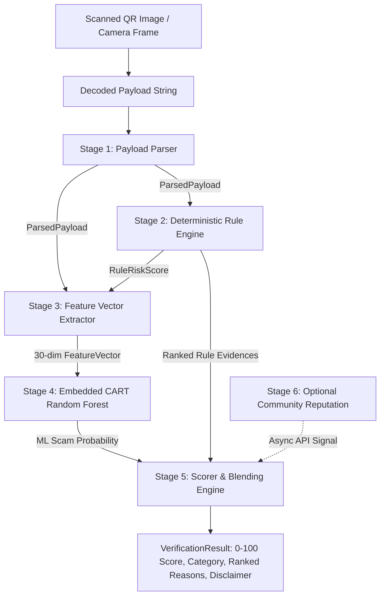

# Project Report Mapping: UPI QR Verifier
> **Cover Title: Payment QR Code Alert System**
> Academic & Technical Project Synopsis to Codebase Mapping Document

This document details how each section of the project synopsis, methodology, algorithmic formulations, risk score categorization tables, and tooling specifications maps directly to concrete TypeScript implementations in this repository.

---

## 1. Methodology Mapping to Source Code



| Methodology Stage | Synopsis Description | Concrete Implementation Files | Key Functions & Classes |
|---|---|---|---|
| **Stage 1: Payload Ingestion & Parsing** | Validates `upi://pay` URI parameters, case normalization, URL decoding, duplicate parameter pollution detection, and non-UPI scheme routing. | [`packages/core/src/parser/upi-parser.ts`](../packages/core/src/parser/upi-parser.ts)<br>[`packages/core/src/parser/url-parser.ts`](../packages/core/src/parser/url-parser.ts)<br>[`packages/core/src/parser/deeplink-parser.ts`](../packages/core/src/parser/deeplink-parser.ts)<br>[`packages/core/src/parser/emv-parser.ts`](../packages/core/src/parser/emv-parser.ts)<br>[`packages/core/src/parser/payload-parser.ts`](../packages/core/src/parser/payload-parser.ts) | `parsePayload()`<br>`parseUpiPayload()`<br>`parseUpiDeepLink()`<br>`parseEmvPayload()`<br>`parseUrlPayload()` |
| **Stage 2: Deterministic Rule Engine** | Pure functional rule checkers evaluating protocol anomalies, PSP allowlists, Shannon entropy, brand impersonation, and refund traps. | [`packages/core/src/rules/rules-protocol.ts`](../packages/core/src/rules/rules-protocol.ts)<br>[`packages/core/src/rules/rules-vpa.ts`](../packages/core/src/rules/rules-vpa.ts)<br>[`packages/core/src/rules/rules-payee.ts`](../packages/core/src/rules/rules-payee.ts)<br>[`packages/core/src/rules/rules-transaction.ts`](../packages/core/src/rules/rules-transaction.ts)<br>[`packages/core/src/rules/rules-payload.ts`](../packages/core/src/rules/rules-payload.ts)<br>[`packages/core/src/rules/rules-emv.ts`](../packages/core/src/rules/rules-emv.ts)<br>[`packages/core/src/rules/rules-community.ts`](../packages/core/src/rules/rules-community.ts)<br>[`packages/core/src/rules/rules-unicode.ts`](../packages/core/src/rules/rules-unicode.ts)<br>[`packages/core/src/rules/engine.ts`](../packages/core/src/rules/engine.ts) | `evaluateRules()`<br>`ALL_RULES`<br>`ruleVpaImpersonation()`<br>`ruleRefundVerifyNote()`<br>`ruleEmvBadCrc()` |
| **Stage 2b: Brand Impersonation & Freshness** | Indian brand and institution keywords (banks, wallets, utilities, govt) with Indian-language transliterations (Devanagari/Latin) and PSP allowlist freshness checks (< 180 days). | [`packages/core/src/validators/brand-validator.ts`](../packages/core/src/validators/brand-validator.ts)<br>[`packages/core/src/validators/brand-keywords.json`](../packages/core/src/validators/brand-keywords.json)<br>[`packages/core/src/validators/psp-allowlist.json`](../packages/core/src/validators/psp-allowlist.json)<br>[`scripts/check-psp-freshness.ts`](../scripts/check-psp-freshness.ts) | `detectBrandImpersonation()`<br>`checkPspFreshness()` |
| **Stage 3: Feature Extraction** | Extracts a versioned 30-dimensional normalized continuous vector in range $[0.0, 1.0]$. | [`packages/core/src/features/feature-schema.ts`](../packages/core/src/features/feature-schema.ts)<br>[`packages/core/src/features/feature-extractor.ts`](../packages/core/src/features/feature-extractor.ts) | `FEATURE_NAMES`<br>`extractFeatureVector()` |
| **Stage 4: On-Device ML Inference** | Zero-dependency recursive tree traversal evaluating a 12-tree Random Forest ensemble evaluated against held-out real scam sources without external C++ or native runtime dependencies. | [`packages/core/src/ml/inference.ts`](../packages/core/src/ml/inference.ts)<br>[`packages/core/src/model/model.json`](../packages/core/src/model/model.json)<br>[`ml/reports/REPORT.md`](../ml/reports/REPORT.md) | `predictTree()`<br>`predictRandomForest()` |
| **Stage 5: Blending & Scoring** | Blends rule score ($65\%$) and ML probability ($35\%$), applies community penalty, clamps to $[0, 100]$, and assigns category & confidence notes. Critical rules strictly override ML. | [`packages/core/src/scoring/config.ts`](../packages/core/src/scoring/config.ts)<br>[`packages/core/src/scoring/scorer.ts`](../packages/core/src/scoring/scorer.ts)<br>[`packages/core/src/verifier.ts`](../packages/core/src/verifier.ts) | `calculateVerificationScore()`<br>`verifyQrPayload()` |
| **Stage 6: Pluggable VPA Verification Layer** | Pluggable verification providers for offline structural, community decay reputation, licensed bank name lookup, and threat intel URL feeds with honest limitation notices. | [`packages/core/src/vpa-verifier/index.ts`](../packages/core/src/vpa-verifier/index.ts)<br>[`packages/core/src/vpa-verifier/offline-structural-verifier.ts`](../packages/core/src/vpa-verifier/offline-structural-verifier.ts)<br>[`packages/core/src/vpa-verifier/community-verifier.ts`](../packages/core/src/vpa-verifier/community-verifier.ts)<br>[`packages/core/src/vpa-verifier/registry.ts`](../packages/core/src/vpa-verifier/registry.ts) | `VpaVerifierRegistry`<br>`verifyVpa()`<br>`computeDecayedReportScore()` |
| **Stage 7: Hardened API & Production Backend** | Fastify backend providing crowd-sourced report storage, rate limiting (global + per-route), 16 KB body limits, redacted request logging (no payloads/VPAs), CORS allowlist, and Zod-matched OpenAPI docs. | [`apps/api/src/app.ts`](../apps/api/src/app.ts)<br>[`apps/api/src/routes/verify.ts`](../apps/api/src/routes/verify.ts)<br>[`apps/api/src/routes/reports.ts`](../apps/api/src/routes/reports.ts)<br>[`apps/api/src/routes/reputation.ts`](../apps/api/src/routes/reputation.ts)<br>[`apps/api/src/db/client.ts`](../apps/api/src/db/client.ts) | `buildApp()`<br>`DatabaseClient`<br>`getVpaReputation()`<br>`insertReport()` |

---

## 2. Algorithm 1: Universal UPI URI Parsing & Parameter Sanitization

### Pseudocode (Synopsis Formulation)
```
Input: Raw scanned string S
Output: Typed ParsedPayload { kind, fields, parseWarnings, hasDuplicateParams }

1. Trim leading and trailing whitespace from S.
2. If Length(S) > 512 characters, append Warning("Oversized payload").
3. If Lowercase(S) starts with "upi://pay":
     a. Extract query substring after '?'.
     b. Split query by '&' delimiter into key-value pairs.
     c. For each pair:
          i. Decode URI percent-encoding safely.
          ii. If key is already seen in parameter map:
                Mark hasDuplicateParams = true, record duplicate key warning.
              Else:
                Store key-value in parameter map.
     d. If mandatory parameter 'pa' is missing or empty, return Failure.
     e. Extract standard fields (pn, am, cu, mc, tr, tn, url).
     f. Collect all non-standard query keys into extraParams.
     g. Return { kind: 'upi', fields: UpiFields, parseWarnings }.
4. Else if Lowercase(S) starts with "http://" or "https://":
     a. Parse URL components (protocol, hostname, pathname, searchParams).
     b. Check for raw IP address regex or bracketed IPv6.
     c. Check hostname against known shortening domains.
     d. Check for punycode encoding ("xn--") and suspicious TLDs.
     e. Return { kind: 'url', fields: UrlFields, parseWarnings }.
5. Else:
     a. Check for non-payment schemes (wifi:, mailto:, tel:, intent:).
     b. Return { kind: 'other', fields: OtherFields, parseWarnings }.
```

### Code Mapping
- Implemented in: [`packages/core/src/parser/upi-parser.ts`](../packages/core/src/parser/upi-parser.ts#L33-L140) and [`packages/core/src/parser/payload-parser.ts`](../packages/core/src/parser/payload-parser.ts#L13-L84).
- Unit Tests: [`packages/core/test/parser.test.ts`](../packages/core/test/parser.test.ts) (Tests 1 through 13).

---

## 3. Algorithm 2: Deterministic Rule Risk Evaluation with Diminishing Headroom

### Pseudocode (Synopsis Formulation)
```
Input: RuleContext { parsed, community }
Output: { allResults, triggeredRules, ruleRiskScore }

1. Initialize triggeredRules = []
2. For each registered rule function Rule_i in ALL_RULES:
     a. Result = Rule_i(RuleContext)
     b. If Result.triggered is True, append Result to triggeredRules.
3. If triggeredRules is empty, return ruleRiskScore = 0.
4. Sort triggeredRules descending by weight W:
     W_sorted = [W_0, W_1, ..., W_k] where W_0 >= W_1 >= ... >= W_k.
5. Initialize AccumulatedScore = W_0.
6. For each subsequent weight W_j from index 1 to k:
     a. Headroom = 100 - AccumulatedScore.
     b. DiminishingFactor = 0.45.
     c. AccumulatedScore = AccumulatedScore + (W_j / 100) * (Headroom * DiminishingFactor).
7. Return ruleRiskScore = Min(100, Round(AccumulatedScore)).
```

### Code Mapping
- Implemented in: [`packages/core/src/rules/engine.ts`](../packages/core/src/rules/engine.ts#L67-L121).
- Unit Tests: [`packages/core/test/rules.test.ts`](../packages/core/test/rules.test.ts) (Tests 31 through 53).

---

## 4. Algorithm 3: On-Device Random Forest Tree Traversal & Score Blending

### Pseudocode (Synopsis Formulation)
```
Input: FeatureVector X, TrainedModel M, RuleRiskScore R, CommunitySignal C
Output: VerificationResult { score, category, reasons, confidenceNote, disclaimer }

1. Traverse each decision tree T_i in M.trees:
     Node = T_i.root
     While Node.isLeaf is False:
       If X[Node.featureIndex] <= Node.threshold:
         Node = Node.leftChild
       Else:
         Node = Node.rightChild
     TreeProbability_i = Node.probability
2. Compute ensemble scam probability:
     P_ml = (1 / nEstimators) * Sum(TreeProbability_i for all i)
3. Compute ML scaled score:
     S_ml = Round(P_ml * 100)
4. Compute Community Penalty:
     P_comm = Min(25, C.reportCount * 8) if C is present else 0
5. Compute Final Blended Score:
     RawScore = (R * 0.65) + (S_ml * 0.35) + P_comm
     FinalScore = Min(100, Max(0, Round(RawScore)))
6. Assign Risk Category:
     If FinalScore <= 30: Category = "SAFE"
     Else if FinalScore <= 70: Category = "SUSPICIOUS"
     Else: Category = "HIGH_RISK"
7. Format ranked reasons by descending impact points.
8. Annotate confidence note (Mandatory caveat for SAFE: "No major risk indicators found; verify the receiver before paying").
```

### Code Mapping
- Implemented in: [`packages/core/src/ml/inference.ts`](../packages/core/src/ml/inference.ts#L7-L40) and [`packages/core/src/scoring/scorer.ts`](../packages/core/src/scoring/scorer.ts#L25-L122).
- Unit Tests: [`packages/core/test/scoring.test.ts`](../packages/core/test/scoring.test.ts) (Tests 54 through 59) and [`packages/core/test/ml-inference.test.ts`](../packages/core/test/ml-inference.test.ts) (Tests 60 through 63).

---

## 5. Risk Score Categorization Table Mapping

| Score Range | Category Code | Color Palette | Mandatory Advisory / Confidence Note | UI Behavior & Action |
|---|---|---|---|---|
| **0 – 30** | `SAFE` | Emerald Green (`#10B981`) | *"No major risk indicators found; recipient identity NOT independently verified"* (Mandatory caveat whenever live bank-registered name lookup is offline or unperformed; never displays an unqualified bare "Safe"). Merchant QRs persistently display the physical sticker tampering alert and the "Check name shown in your UPI app before entering PIN" verification step. | Allows dismissal with standard advice. Does not launch payment automatically. Renders audit card of executed vs unperformed checks. |
| **31 – 70** | `SUSPICIOUS` | Amber Orange (`#F59E0B`) | *"Caution: Recipient uses an unverified PSP handle or exhibits atypical parameters. Verify identity independently."* | Highlights medium risk factors (mismatched name, missing MCC, round lure amount, brand similarity). |
| **71 – 100** | `HIGH_RISK` | Crimson Red (`#EF4444`) | *"HIGH RISK: Critical fraud indicators or deceptive patterns detected. Do NOT proceed with payment."* | Displays prominent alert reticle. Tapping "Continue Anyway" triggers an explicit two-step confirmation modal (`CRITICAL SCAM WARNING`) preventing accidental click-throughs. |

---

## 6. Tools & Technologies Matrix Mapping

| Technology / Component | Synopsis Specified Role | Repository Location | Version / Specification |
|---|---|---|---|
| **TypeScript (Strict)** | Unified language across core, backend, mobile, and ML scripts | Whole repository (`tsconfig.base.json`) | `TypeScript 5.7.3` (`noImplicitAny`, strict mode, zero `any`) |
| **pnpm Workspaces** | Monorepo package management and symlinked isolation | Root [`pnpm-workspace.yaml`](../pnpm-workspace.yaml) | `pnpm v12.10.1` |
| **Vitest & Testing Suite** | Unit, integration, property-based, real-world image acceptance, and React Native UI test runner | [`packages/core/vitest.config.ts`](../packages/core/vitest.config.ts)<br>[`apps/api/vitest.config.ts`](../apps/api/vitest.config.ts)<br>[`apps/mobile/vitest.config.ts`](../apps/mobile/vitest.config.ts) | `Vitest 3.0.7` / `5.1.1` (426 total automated tests across core, api, ml, and mobile) |
| **Real-World Acceptance Suite** | End-to-end QR PNG image decoding and security verification across clean and degraded variants (rotated 15°, blurred, JPEG-compressed, low contrast, screen photographed) | [`docs/real-world-fixtures/`](../docs/real-world-fixtures/)<br>[`apps/mobile/test/real-world-acceptance.test.ts`](../apps/mobile/test/real-world-acceptance.test.ts)<br>[`packages/core/test/real-world-acceptance.test.ts`](../packages/core/test/real-world-acceptance.test.ts)<br>[`packages/core/test/acceptance-15.test.ts`](../packages/core/test/acceptance-15.test.ts)<br>[`apps/mobile/test/acceptance-15.test.ts`](../apps/mobile/test/acceptance-15.test.ts) | 29 PNG fixtures + `manifest.json`, 100 dedicated acceptance test assertions |
| **Manual Real-Device Checklist** | Protocol for real shop stands, phone screens, WhatsApp screenshots, low light, and glare with safety directives and logging template | [`docs/REAL_WORLD_TESTING.md`](../docs/REAL_WORLD_TESTING.md) | 5 comprehensive physical testing protocols, triage instructions |
| **fast-check** | Property-based and fuzz testing across universal payload parsers | [`packages/core/test/fuzz-parsers.test.ts`](../packages/core/test/fuzz-parsers.test.ts) | `fast-check 3.23.2` (1000+ arbitrary Unicode and mutated payload runs) |
| **Fastify** | High-performance backend API service with rate limiting (429) and body limits (16 KB) | [`apps/api/src/server.ts`](../apps/api/src/server.ts)<br>[`apps/api/src/app.ts`](../apps/api/src/app.ts) | `Fastify 5.2.1`, `@fastify/rate-limit 10.2.2`, `@fastify/cors 10.0.2` |
| **better-sqlite3** | Embedded high-speed SQLite database with WAL mode | [`apps/api/src/db/client.ts`](../apps/api/src/db/client.ts) | `better-sqlite3 11.8.1` |
| **Zod** | Runtime schema validation and boundary validation | [`apps/api/src/schemas/index.ts`](../apps/api/src/schemas/index.ts) | `Zod 3.24.2` |
| **OpenAPI / Swagger** | Interactive API documentation matching Zod constraints | [`apps/api/src/app.ts`](../apps/api/src/app.ts) | `@fastify/swagger 9.4.2` (`/openapi.json`, `/documentation`) |
| **Expo & React Native** | Cross-platform mobile and web application | [`apps/mobile/`](../apps/mobile/) | `Expo SDK 52`, `React Native 0.76.7`, `react-native-web 0.19.13` |
| **React Native Testing Library** | Verification of Result Screen policy rules, honest caveats, and two-step modals | [`apps/mobile/test/result-policy.test.tsx`](../apps/mobile/test/result-policy.test.tsx) | `@testing-library/react-native 14.1.0`, `react-test-renderer 18.3.1` |
| **expo-camera & jsQR** | Dual mobile camera and browser canvas QR scanning | [`apps/mobile/app/scan.tsx`](../apps/mobile/app/scan.tsx)<br>[`apps/mobile/lib/web-qr.ts`](../apps/mobile/lib/web-qr.ts) | `expo-camera 16.0.17`, `jsQR 1.4.0` |
| **Docker & Compose** | Containerized deployment with SQLite volume persistence | Root [`docker-compose.yml`](../docker-compose.yml)<br>[`apps/api/Dockerfile`](../apps/api/Dockerfile) | Multi-stage `node:22-alpine` with healthcheck |
| **GitHub Actions CI** | CI workflow with linting, typechecking, tests, freshness, mobile web export, Docker build, and nightly fixtures | [`.github/workflows/ci.yml`](../.github/workflows/ci.yml) | Multi-job matrix with pnpm caching and cron triggers |

---

## 7. Real-World Acceptance Test Suite: 15 Core Scenarios Matrix

The real-world acceptance test suite covers 15 critical scenarios across core parsing/rule verification ([`packages/core/test/acceptance-15.test.ts`](../packages/core/test/acceptance-15.test.ts)) and mobile image decoding / user interface flows ([`apps/mobile/test/acceptance-15.test.ts`](../apps/mobile/test/acceptance-15.test.ts)):

| Scenario # | Payload Type / Test Vector | Expected Score / Category | Implementation & Verification Mapping |
|---|---|---|---|
| **1** | Valid `upi://pay` merchant with MCC | `SAFE` (Score $\le 30$) with mandatory caveat | Emits `"No major risk indicators found; recipient identity NOT independently verified"` (caveat required when bank lookup is offline). Merchant QRs persistently display standee sticker tamper advisory. |
| **2** | P2P phone-number VPA | `SAFE` (Score $\le 30$) | Recognized as standard legitimate peer-to-peer 10-digit mobile number (`isPhoneVpa: true`). |
| **3** | Valid EMVCo BharatQR with correct CRC | `SAFE` (Score $\le 30$) | Strict CRC-16/CCITT-FALSE validation over tag `6304`; `RULE_EMV_BAD_CRC` does NOT trigger. |
| **4** | EMV QR with single altered character | `SUSPICIOUS` or higher | Bitwise checksum mismatch triggers `RULE_EMV_BAD_CRC` (`severity: high`, weight 75). |
| **5** | EMV QR with swapped VPA & valid recalculated CRC | Evaluated normally by rules | CRC check passes; evaluated on new VPA semantics (legitimate merchant $\rightarrow$ `SAFE`; deceptive bank helpline $\rightarrow$ `HIGH_RISK`). |
| **6** | Deep links (`phonepe://pay`, `paytmmp://pay`) | Parsed identically to `upi://` | Normalized into standard `UpiFields` preserving `originalScheme` for app launching. |
| **7** | Debit pull requests (`upi://collect?...`) | `HIGH_RISK` | Triggers `RULE_COLLECT_OR_MANDATE` (`severity: high`, weight 75). Warns user that scanning deducts money. |
| **8** | "Refund / KYC / prize" scam text in `tn` | `HIGH_RISK` | Triggers `RULE_REFUND_VERIFY_NOTE` (`severity: critical`, weight 85). Critical rule overrides ML to ensure high risk. |
| **9** | Bank-helpline impersonation VPA | `HIGH_RISK` | Triggers `RULE_VPA_IMPERSONATION` (`severity: critical`, weight 85) targeting deceptive banking handles. |
| **10** | Shortened URL, IP host, Punycode, HTTP | `HIGH_RISK` | Triggers `RULE_SHORTENED_URL`, `RULE_IP_ADDRESS_URL`, `RULE_PUNYCODE_DOMAIN`, and `RULE_HTTP_NOT_HTTPS`. |
| **11** | Parameter pollution (`pa` specified twice) | `HIGH_RISK` | Identifies duplicate query keys (`hasDuplicateParams: true`) and triggers `RULE_DUPLICATE_PARAMETERS`. |
| **12** | Hidden unicode / homoglyphs in `pn` | `SUSPICIOUS` or higher | Detects Cyrillic/Greek lookalike glyphs and invisible characters, triggering `RULE_HIDDEN_UNICODE`. |
| **13** | Non-payment utility QRs (`wifi:`, `mailto:`, `tel:`) | "Not a payment QR" (Score 0) | Early categorization as `SAFE` (`isNonPaymentQr: true`); explicitly clarifies benign utility nature. |
| **14** | Image containing 2 QR codes | UI candidate selection sheet | Multi-QR decoder extracts all distinct codes; displays `MultipleQrModal` forcing explicit user selection ("never silently pick one"). |
| **15** | Image with no QR code | Clear error with actionable tips | Multi-pass decoder returns 0 codes; displays diagnostic guidance (adjust lighting, avoid glare, clean lens). |

